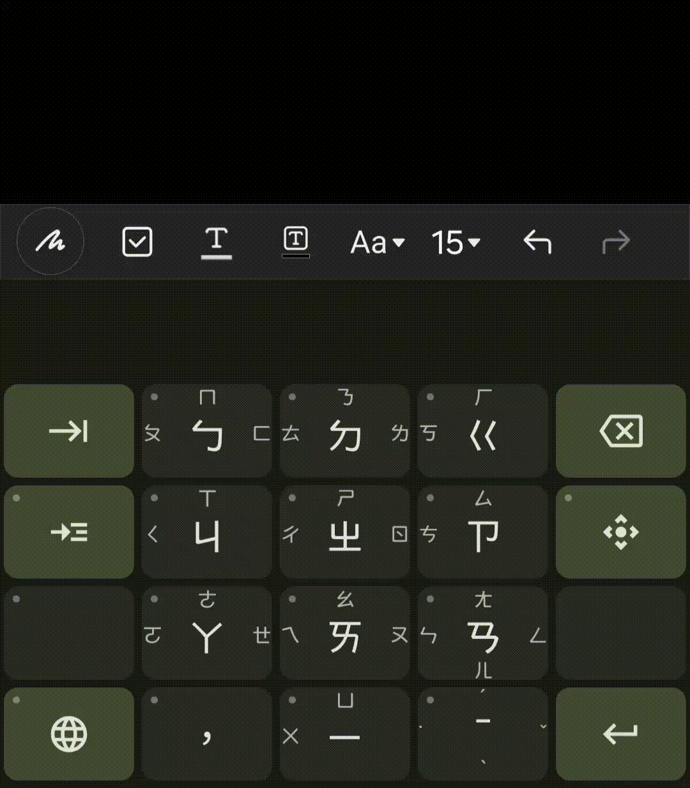
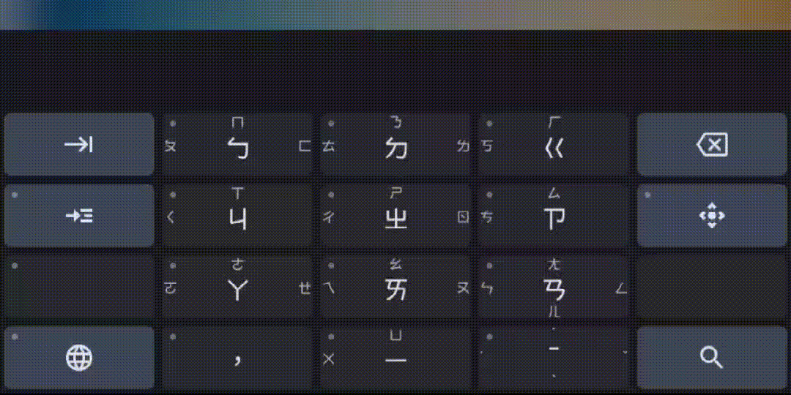
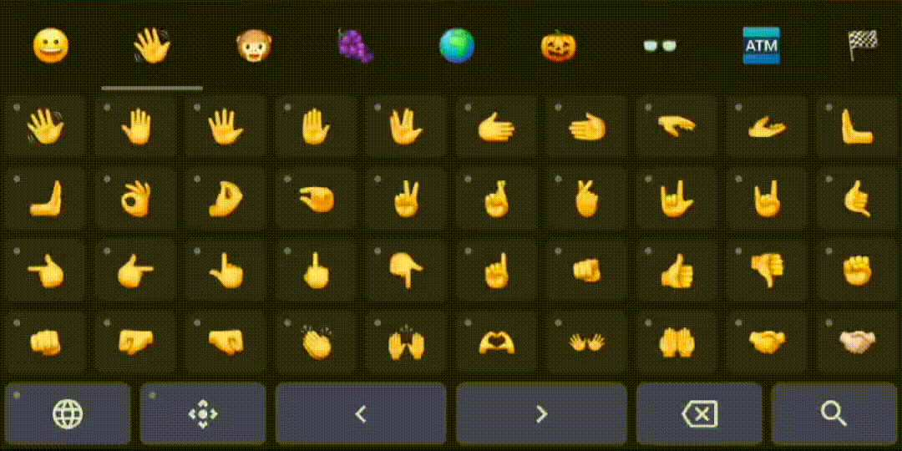
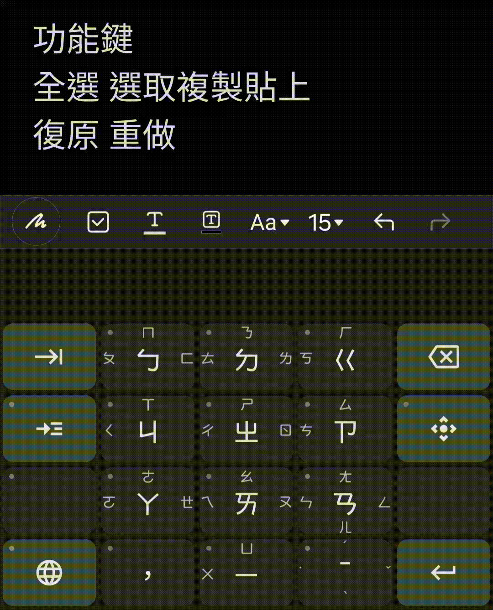

# Flick注音輸入法
**Flick注音輸入法** 是一個 100% 使用 **Kotlin** 與 **Jetpack Compose** 開發的現代化Android輸入法。

核心主打為 **Flick注音** 輸入模式，旨在透過 flick 的方式拖曳按鍵，讓小螢幕能更好打字，不再昂鞥而。

本專案為[Flick行列輸入法](https://github.com/crest247/FlickArrayKeyboard)之延伸專案。

## 核心特色
* **Flick按鍵**：**左上角加上小點的按鍵**，按住即可預覽所有功能，拖曳滑動到不同方向即可操作對應的功能。
* **注音**：採用九宮格的按鍵佈局，可以透過觸控螢幕的flick拖曳操作來輸入注音。
* **特殊功能鍵與D-Pad**：
  * **D-Pad**：在數個輸入模式中皆可單獨使用，提供拖曳實現游標移動的功能。
  * **特殊功能鍵**：此功能僅在 **注音** 模式中實作。使用者可以透過向下拖曳不放，或向上拖曳不放，來分別觸發 `Ctrl` 或 `Shift` 狀態。而D-Pad鍵會與特殊功能鍵產生交互作用，進而實現全選、複製、貼上、復原、重做，以及選取上下行或前後字元、shift+enter 等進階文字編輯功能，免去觸控螢幕長按選取文字的繁瑣操作。
* **Flick語言切換鍵**：語言切換鍵使用flick的方式，能夠一步直達指定的輸入模式，免去傳統設計需要連續點擊依序切換語言或需要設計多個不同的按鍵。

## 輸入模式
* **注音** ：透過滑動拖曳的方式來輸入注音。
* **英文**：一般的英文鍵盤，雙擊⇧可以鎖定大寫。
* **數字**：提供0~9以及多種符號可供輸入。
* **符號**：提供多種常用全形半形符號、箭頭符號、數學符號以及希臘字母。
* **Emoji**：提供各式各樣的Emoji，並且可以透過flick的方式選擇膚色。

## 架構設計
* 本專案不使用傳統的Android XML佈局，而是全面使用 **Jetpack Compose** 開發，並採用高度模組化的架構設計。
* **模組化分工**：不同的輸入模式皆拆分為獨立的資料夾模組。核心程式碼只負責通用的排版與手勢分發等，新增或修改單一輸入模式不需更動到核心邏輯，易於後續擴充與維護。
* **集中管理的尺寸與主題**：統一管理所有的尺寸與色彩，讓鍵盤能依據設備狀態（如手機或平板、直向或橫向、深色或淺色）自動適應並重繪。
* **資料與 UI 解耦**：鍵盤的UI排版、觸控手勢分發與底層的字根解碼、邏輯處理完全隔離。UI層僅透過抽象的資料模型進行渲染，並將手勢意圖轉換為通用的按鍵事件交由後端處理。

## 影片示範
### 輸入文字

### 切換模式

### Emoji輸入

### 功能鍵使用

## 候選字模型
* 以「資料來源」中的句子為訓練資料，從零開始訓練出小型 GRU 語言模型，權重與本專案一同以 MIT License 釋出。
* 輸入注音時，語言模型會根據上下文排出候選字與整句建議，整個過程無需網路即可在手機上完成。

## 資料來源
* **文字**：教育部《異體字字典》正字表。
* **注音**：取自全字庫 CNS11643（政府資料開放授權條款第 1 版）。
* **句子**：取自 Hugging Face 資料集 [yentinglin/twllm-data](https://huggingface.co/datasets/yentinglin/twllm-data)（Apache 2.0）。
  * 使用 [g2pW](https://github.com/GitYCC/g2pW)（Apache 2.0）產生注音。
  * 使用 [jieba](https://github.com/fxsjy/jieba)（MIT）進行斷詞。
  * 濾除一些簡體中文的句子。

## 授權條款
本專案採用 MIT License 釋出，使用者可自由使用、修改、重製或散佈本專案之程式碼與模型權重，並請於衍生作品中保留授權條款與著作權聲明（[詳全文](https://github.com/crest247/FlickBopomofo/blob/master/LICENSE)）。